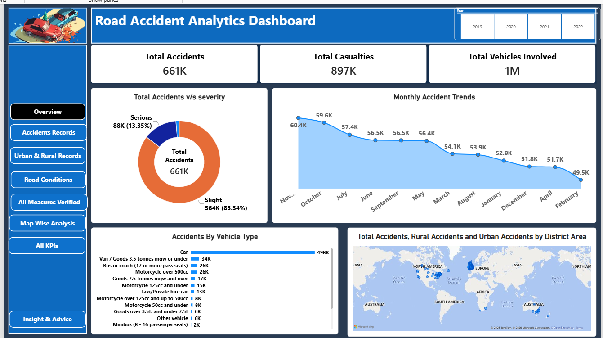

Road Accident Analytics Dashboard (Power BI)

An interactive, multi-page Power BI dashboard that analyses 660,679 road accident records (2019-2022) across 422 UK districts. The project covers the full analytics workflow: data cleaning in Power Query, DAX measure design, 15 business questions answered with visuals, and a navigated dashboard with an insights page.

1. Overview

KPI cards, severity split, monthly trend, vehicle types and accident map on a single page.

  

## Table of Contents
1. [Project Overview](#project-overview)
2. [Business Questions](#business-questions)
3. [Dataset](#dataset)
4. [Tools & Skills](#tools--skills)
5. [Project Workflow](#project-workflow)
6. [Data Cleaning (Power Query)](#data-cleaning-power-query)
7. [DAX Measures](#dax-measures)
8. [Dashboard Pages](#dashboard-pages)
9. [Key Insights](#key-insights)
10. [Data Quality Notes](#data-quality-notes)
11. [How to Open This Project](#how-to-open-this-project)
12. [Repository Structure](#repository-structure)
13. [Future Improvements](#future-improvements)
14. [Author](#author)

---
Project Overview

Road accidents cause significant loss of life and cost. This project explores where, when, and under what conditions accidents happen, and how severe they are, so that patterns can be turned into decisions (for example, where to focus road-safety measures).

Headline numbers

Metric	Value
Total accidents	660,679
Total casualties	896,568
Total vehicles involved	1,209,872
Avg. casualties per accident	1.36
Avg. vehicles per accident	1.83
Districts covered	422
Period covered	1 Jan 2019 - 31 Dec 2022

Business Questions

The dashboard answers these 15 analysis queries:

#	Question	Visual used
1	Total number of accidents	Card
2	Total number of casualties	Card
3	Total number of vehicles involved	Card
4	Accidents by severity (Fatal / Serious / Slight)	Donut chart
5	District with the most accidents	Bar chart / Map
6	Accidents by road type	Clustered bar chart
7	Vehicle type involved in most accidents	Column chart
8	Effect of weather conditions on accident frequency	Stacked bar chart
9	Impact of light conditions	Column chart
10	Road surface condition vs. severity	Matrix
11	Urban vs. rural accidents	Pie chart
12	Monthly accident trend	Line chart
13	Month with the highest casualties	Area chart
14	Average casualties per accident by district	Bar chart
15	Accident locations (Latitude & Longitude)	Map visual

Dataset
File: accident_data.csv
Size: 660,679 rows x 14 columns
Period: 2019-2022 (dates stored as DD-MM-YYYY)
Column	Description
Index	Accident reference ID
Accident_Severity	Fatal / Serious / Slight
Accident Date	Date of the accident
Latitude, Longitude	Location coordinates
Light_Conditions	Daylight / Darkness (lit, unlit, no lighting, unknown)
District Area	UK district (422 unique)
Number_of_Casualties	Casualties in the accident
Number_of_Vehicles	Vehicles involved
Road_Surface_Conditions	Dry, Wet or damp, Frost or ice, Snow, Flood
Road_Type	Single / Dual carriageway, Roundabout, One way street, Slip road
Urban_or_Rural_Area	Urban / Rural / Unallocated
Weather_Conditions	Fine, Raining, Snowing, Fog or mist (with/without high winds), etc.
Vehicle_Type	Car, Van, Bus, Motorcycle (various), Goods vehicle, etc.

Add the original dataset source link here: [Source name](URL)

Tools & Skills
Power BI Desktop - data modelling, report design, navigation
Power Query (M) - data cleaning and transformation
DAX - measures (CALCULATE, DIVIDE, MAXX, RANKX, ALL, VALUES)
Data visualization - donut, bar, column, line, area, matrix, map, KPI cards
Dashboard UX - page navigation buttons, consistent theme, header banner
Project Workflow
Data understanding - profiled rows, columns, types and missing values
Data cleaning - handled nulls, fixed date locale, standardised text, created date parts
Data modelling - single flat table, Year / Month / Month Name columns, severity sort order
DAX measures - 16 measures grouped by purpose (KPIs, ratios, severity, urban/rural, time, ranking)
Visual building - one or more visuals for each of the 15 questions
Verification - a dedicated page cross-checks every measure against the raw data
Navigation & insights - page navigation system plus a final insights page
Data Cleaning (Power Query)
Issue	Action
Blank Road_Type (4,520 rows)	Replaced with Unknown
Blank Road_Surface_Conditions (726 rows)	Replaced with Unknown
Blank Weather_Conditions (~14K rows)	Replaced with Unknown
Blank Urban_or_Rural_Area (15 rows)	Replaced with Unknown
Error values in Latitude / Longitude	Replace Errors with null (kept the rows; the map skips blanks)
Accident Date stored as text DD-MM-YYYY	Converted using Change Type > Using Locale > English (United Kingdom) to avoid day/month swaps
Stray spaces / hidden characters	Applied Trim and Clean to all text columns
No time columns	Added Year, Month, Month Name
Alphabetical severity order	Added Severity Sort Order (Slight=1, Serious=2, Fatal=3) and used Sort by Column

Why "Unknown" instead of deleting or guessing? Deleting rows would distort the totals, and filling with the most common value (for example "Dry") would inflate that category and bias the severity analysis. "Unknown" keeps every record countable and honest.

